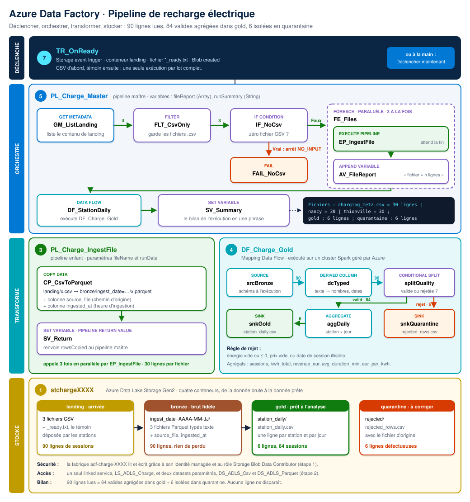
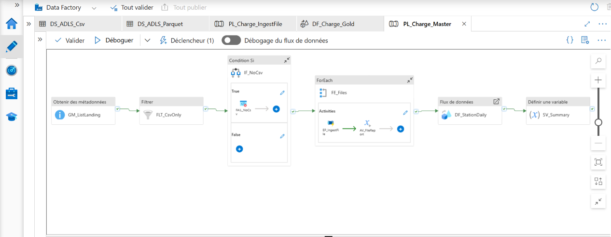
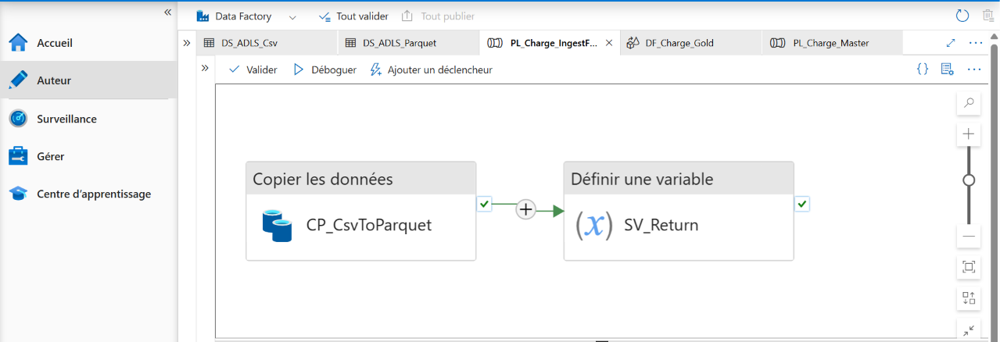
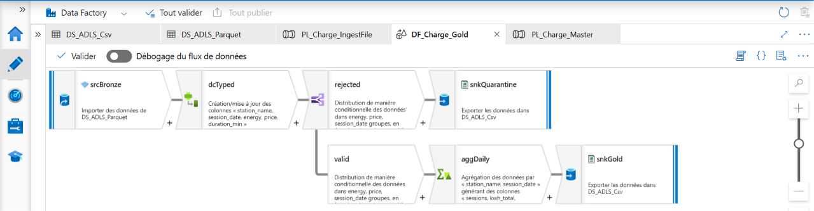
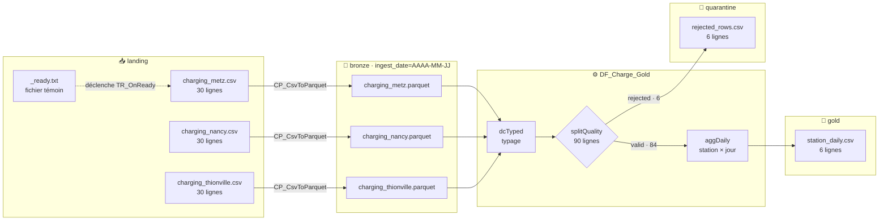

<a id="top"></a>

<div align="center">

# ⚡ Azure Data Factory · Guide n° 1 · Pipeline de recharge électrique

**Un pipeline de production sur Azure Data Factory : découverte automatique des fichiers, ingestion parallèle par pipeline enfant, contrôle qualité Spark, quarantaine des lignes défectueuses et déclenchement par événement de stockage. Sans clé, sans mot de passe, sans planification.**


**[📘 Guide n° 1 pas à pas (PDF, 7 pages)](docs/Guide_ADF_Recharge_Public_1.pdf)** · **[📂 Données source](data/)** · **[🏗️ Architecture](#architecture)** · **[🚀 Reproduire](#reproduire)**

<br/>



<sub>Quatre couches, de haut en bas : ce qui déclenche, ce qui orchestre, ce qui transforme, où vivent les données. Les nombres sur les flèches sont les volumes réellement observés à l'exécution.</sub>

</div>

---

## ⚡ En bref

| 📥 Entrée | ⚙️ Traitement | 📤 Sortie |
|:---:|:---:|:---:|
| **3 fichiers CSV** déposés par 3 stations de recharge, puis un fichier témoin `_ready.txt` | **1 pipeline maître**, **1 pipeline enfant** lancé 3 fois en parallèle, **1 data flow Spark**, **1 déclencheur événementiel** | **6 indicateurs quotidiens** dans gold, **6 lignes défectueuses** en quarantaine, **0 ligne perdue** |

> **Série Azure Data Factory, guide n° 1.** Chaque guide de la série construit un pipeline complet, reproductible de bout en bout, avec ses données, son diagramme et son guide PDF. Les suivants paraîtront dans `adf-pipeline-express-2`, `adf-pipeline-express-3`, et ainsi de suite.

---

## 🖼️ Aperçu

### Le pipeline maître `PL_Charge_Master`

Il découvre les fichiers déposés, s'arrête proprement si rien n'est arrivé, ingère les fichiers trois par trois, lance le data flow puis écrit le bilan de l'exécution.



### Le pipeline enfant `PL_Charge_IngestFile`

Il ingère un seul fichier, du CSV vers le Parquet, et renvoie au pipeline maître le nombre de lignes copiées.



### Le data flow `DF_Charge_Gold`

Il type les données, sépare les lignes valides des lignes défectueuses, agrège par station et par jour, et écrit deux sorties : gold et quarantaine.



---

<a id="resultats-cles"></a>

## 📊 Résultats clés

| Indicateur | Résultat |
|---|---|
| Fichiers découverts automatiquement | **3** CSV, le fichier témoin `_ready.txt` étant écarté par le filtre |
| Exécutions du pipeline enfant | **3**, lancées **en parallèle** |
| Lignes lues | **90** (30 par station) |
| Lignes valides agrégées dans gold | **84** sessions, résumées en **6** lignes (3 stations × 2 jours) |
| Lignes isolées en quarantaine | **6**, chacune avec son fichier d'origine |
| Lignes perdues | **0** : 90 = 84 + 6 |
| Énergie délivrée | **2 476,91 kWh** |
| Chiffre d'affaires | **1 009,58 €** |
| Secrets stockés | **0** : authentification par identité managée |
| Clics nécessaires pour lancer un lot | **0** : le dépôt de `_ready.txt` déclenche tout |

**Le résultat publié dans `gold/station_daily/station_daily.csv` :**

| Station | Jour | Sessions | kWh | Chiffre d'affaires (€) | Durée moyenne (min) | Prix moyen du kWh (€) |
|---|---|---:|---:|---:|---:|---:|
| Metz Gare | 2026-10-12 | 14 | 429,51 | 177,51 | 58,9 | 0,413 |
| Metz Gare | 2026-10-13 | 14 | 377,19 | 155,62 | 62,0 | 0,413 |
| Nancy Stanislas | 2026-10-12 | 14 | 417,32 | 183,26 | 62,9 | 0,439 |
| Nancy Stanislas | 2026-10-13 | 14 | 369,61 | 162,74 | 55,7 | 0,440 |
| Thionville Centre | 2026-10-12 | 14 | 415,98 | 155,74 | 47,4 | 0,374 |
| Thionville Centre | 2026-10-13 | 14 | 467,30 | 174,71 | 51,4 | 0,374 |

**Le bilan écrit par le pipeline lui-même, dans la variable `runSummary` :**

```text
Fichiers : charging_metz.csv = 30 lignes | charging_nancy.csv = 30 lignes | charging_thionville.csv = 30 lignes ; gold : 6 lignes ; quarantaine : 6 lignes
```

---

## 💼 Impact métier

Un opérateur de bornes de recharge exploite trois stations en Lorraine : **Metz Gare**, **Nancy Stanislas** et **Thionville Centre**. Chaque station dépose chaque jour le fichier CSV de ses sessions. Ce pipeline transforme ces dépôts bruts en indicateurs de pilotage, sans intervention humaine.

- **Des chiffres justes.** Une énergie négative ou vide ne fausse plus le chiffre d'affaires ni le prix moyen du kWh : la ligne est écartée avant l'agrégation.
- **Aucune donnée perdue.** Les lignes écartées ne sont pas supprimées. Elles sont rangées en quarantaine, avec le nom de leur fichier d'origine, pour être renvoyées à la station concernée.
- **Une comparaison directe des stations.** Thionville vend son kWh 0,374 €, Nancy 0,439 € à 0,440 € : l'écart de prix entre sites saute aux yeux dès la première exécution.
- **Un traitement qui suit le rythme du terrain.** Le pipeline démarre dès qu'un lot est complet, ni trop tôt sur un lot à moitié arrivé, ni trop tard après une heure fixe arbitraire.
- **Une sécurité de production.** Aucune clé de compte ni chaîne de connexion à protéger ou à renouveler.
- **Un coût maîtrisé.** Tout est facturé à l'usage, et un seul groupe de ressources permet de tout supprimer d'un geste.

---

## 🧭 Synthèse

Ce projet montre comment construire sur **Azure Data Factory** un pipeline qui a les réflexes d'un traitement de production, et pas seulement d'une démonstration :

1. **Il se déclenche seul** quand le fichier témoin `_ready.txt` arrive dans le conteneur `landing`, grâce à un *Storage event trigger* adossé à Azure Event Grid.
2. **Il découvre ses fichiers** avec *Get Metadata* puis *Filter*, au lieu de lister des noms en dur.
3. **Il se protège** : si aucun CSV n'est arrivé, une *If Condition* déclenche une activité *Fail* avec le message et le code d'erreur `NO_INPUT`.
4. **Il ingère en parallèle** : un *ForEach* appelle trois fois un pipeline enfant, qui renvoie son nombre de lignes grâce à la *Pipeline return value*.
5. **Il trace chaque ligne** : la couche bronze est partitionnée par date (`ingest_date=AAAA-MM-JJ`) et enrichie des colonnes `source_file` et `ingested_at`.
6. **Il contrôle la qualité** dans un *Mapping Data Flow* exécuté sur Spark : typage, séparation des lignes valides et rejetées, agrégation par station et par jour.
7. **Il rend compte** de son exécution en une phrase, lisible dans l'onglet Surveillance.

---

## ⚙️ Le pipeline

### Pipeline maître `PL_Charge_Master`

| # | Activité | Type | Rôle |
|:-:|---|---|---|
| 1 | `GM_ListLanding` | Get Metadata | Liste le contenu du conteneur `landing` (*Child items*) |
| 2 | `FLT_CsvOnly` | Filter | Garde uniquement les fichiers `.csv` et écarte le témoin `_ready.txt` |
| 3 | `IF_NoCsv` | If Condition | Teste si aucun CSV n'a été trouvé |
| 3a | `FAIL_NoCsv` | Fail | Branche Vrai : arrête l'exécution avec le code `NO_INPUT` |
| 4 | `FE_Files` | ForEach | Parcourt les CSV en parallèle, trois à la fois |
| 4a | `EP_IngestFile` | Execute Pipeline | Appelle le pipeline enfant et attend sa fin |
| 4b | `AV_FileReport` | Append variable | Ajoute « fichier = n lignes » au rapport |
| 5 | `DF_StationDaily` | Data flow | Exécute `DF_Charge_Gold` sur la partition du jour |
| 6 | `SV_Summary` | Set variable | Assemble le bilan final de l'exécution |

### Pipeline enfant `PL_Charge_IngestFile`

| # | Activité | Type | Rôle |
|:-:|---|---|---|
| 1 | `CP_CsvToParquet` | Copy data | `landing/x.csv` vers `bronze/ingest_date=AAAA-MM-JJ/x.parquet`, avec `source_file` et `ingested_at` |
| 2 | `SV_Return` | Set variable | Renvoie `rowsCopied` au pipeline maître (*Pipeline return value*) |

### Data flow `DF_Charge_Gold`

| Étape | Transformation | Ce qu'elle fait |
|---|---|---|
| `srcBronze` | Source | Lit le Parquet du jour, schéma découvert à l'exécution (*schema drift*) |
| `dcTyped` | Derived column | Convertit le texte en nombres et en dates avec `byName()`, calcule la durée de chaque session |
| `splitQuality` | Conditional split | Rejette les lignes à l'énergie vide ou négative, au prix vide ou à la date illisible |
| `aggDaily` | Aggregate | Sessions, kWh, chiffre d'affaires, durée moyenne et prix moyen du kWh par station et par jour |
| `snkGold` | Sink | Écrit `gold/station_daily/station_daily.csv` |
| `snkQuarantine` | Sink | Écrit `quarantine/rejected/rejected_rows.csv` |

### Les choix qui font la différence

- **Deux datasets génériques au lieu d'un par fichier.** `DS_ADLS_Csv` et `DS_ADLS_Parquet` reçoivent en paramètres le conteneur, le dossier et le fichier. Ils servent six fois dans le projet et serviraient pour cent fichiers sans rien recréer.
- **Un découpage maître et enfant.** Azure Data Factory n'autorise pas un ForEach dans un If. Le pipeline enfant contourne cette limite, rend l'ingestion réutilisable et isole chaque fichier dans sa propre exécution.
- **Une valeur de retour entre pipelines.** Le pipeline enfant renvoie `rowsCopied`, que le maître lit avec `activity('EP_IngestFile').output.pipelineReturnValue.rowsCopied`.
- **Un prix moyen du kWh calculé juste.** Il est obtenu en divisant un total par un total, et non en faisant la moyenne de prix unitaires : c'est la seule formule correcte quand les sessions n'ont pas la même taille.
- **Un motif de fichier témoin.** Déclencher sur `_ready.txt` plutôt que sur chaque CSV évite trois exécutions concurrentes sur un lot incomplet.

---

## 🔗 Lignage des données



| Couche | Contenu | Format | Volume |
|---|---|---|---|
| `landing` | Fichiers déposés par les stations, plus le témoin | CSV | 90 lignes |
| `bronze` | Copie fidèle, partitionnée par date, avec `source_file` et `ingested_at` | Parquet | 90 lignes |
| `gold` | Indicateurs quotidiens par station | CSV | 6 lignes (84 sessions) |
| `quarantine` | Lignes défectueuses, avec leur fichier d'origine | CSV | 6 lignes |

---

<a id="architecture"></a>

## 🏗️ Architecture

Le diagramme complet ouvre cette page, [tout en haut](#top). Il se lit de haut en bas, en quatre couches : **ce qui déclenche**, **ce qui orchestre**, **ce qui transforme** et **où vivent les données**. Ses pastilles numérotées renvoient aux étapes du [guide n° 1](docs/Guide_ADF_Recharge_Public_1.pdf), et les nombres portés par les flèches sont les volumes réellement observés à l'exécution. [Ouvrir le diagramme en grand](docs/images/architecture.svg).

| Ressource Azure | Nom | Rôle |
|---|---|---|
| Groupe de ressources | `rg-adf-charge` | Regroupe tout le projet, et permet de tout supprimer d'un seul geste |
| Compte de stockage ADLS Gen2 | `stchargeXXXX` | Lac de données avec espace de noms hiérarchique et quatre conteneurs |
| Data Factory V2 | `adf-charge-XXXX` | Orchestration, copie et data flow |
| Identité managée | celle de la fabrique | Rôle **Storage Blob Data Contributor** sur le compte de stockage |
| Linked service | `LS_ADLS_Charge` | Seule connexion au lac, authentifiée par identité managée |
| Déclencheur | `TR_OnReady` | *Storage event trigger* sur `landing`, fichier `_ready.txt`, événement *Blob created* |

---

## 🧰 Stack technique

| Domaine | Technologie |
|---|---|
| Orchestration | Azure Data Factory V2 : pipelines, Execute Pipeline, ForEach, If Condition, Fail, variables |
| Transformation | Mapping Data Flow sur Spark : Derived column, Conditional split, Aggregate |
| Stockage | Azure Data Lake Storage Gen2, couches landing, bronze, gold et quarantine |
| Formats | CSV en entrée, Parquet compressé en snappy pour bronze, CSV pour gold et quarantine |
| Sécurité | Identité managée, Microsoft Entra ID, contrôle d'accès en fonction du rôle (RBAC) |
| Événementiel | Azure Event Grid, via le *Storage event trigger* d'ADF |
| Paramétrage | Datasets génériques, expressions dynamiques, valeur de retour de pipeline |

---

<a id="reproduire"></a>

## 🚀 Reproduire le projet

Tout est fourni pour refaire ce pipeline dans votre propre abonnement Azure. Le compte gratuit suffit.

1. Téléchargez le **[guide n° 1 pas à pas (PDF, 7 pages)](docs/Guide_ADF_Recharge_Public_1.pdf)**. Chaque valeur à saisir y figure dans un bloc à copier, et chaque choix est expliqué.
2. Téléchargez les quatre fichiers du dossier **[`data/`](data/)** : `charging_metz.csv`, `charging_nancy.csv`, `charging_thionville.csv` et `_ready.txt`. Ils sont aussi joints dans le PDF.
3. Suivez les huit étapes du guide : préparer Azure, créer la connexion et les datasets, construire le pipeline enfant, le data flow et le pipeline maître, publier et vérifier, ajouter le déclencheur, puis **tout fermer** pour ne plus rien consommer.
4. Comparez votre `station_daily.csv` au tableau de la section [Résultats clés](#resultats-cles) : les chiffres doivent être identiques.

### Structure du dépôt

```text
adf-pipeline-express-1/
├── README.md
├── data/
│   ├── charging_metz.csv          30 sessions, dont 2 défectueuses
│   ├── charging_nancy.csv         30 sessions, dont 2 défectueuses
│   ├── charging_thionville.csv    30 sessions, dont 2 défectueuses
│   └── _ready.txt                 fichier témoin qui déclenche le pipeline
└── docs/
    ├── Guide_ADF_Recharge_Public_1.pdf
    └── images/
        ├── architecture.svg
        ├── pipeline-maitre.png
        ├── pipeline-enfant.png
        └── data-flow.png
```

### Le jeu de données

Chaque fichier contient les sessions de recharge de deux journées, le 12 et le 13 octobre 2026.

| Colonne | Description | Exemple |
|---|---|---|
| `session_id` | Identifiant de la session | `MET-0001` |
| `station` | Nom de la station | `Metz Gare` |
| `charger_id` | Borne utilisée | `MET-B2` |
| `start_time` | Début de la session | `2026-10-12 15:58:00` |
| `end_time` | Fin de la session | `2026-10-12 17:01:00` |
| `energy_kwh` | Énergie délivrée, en kWh | `24.97` |
| `price_eur` | Montant payé, en euros | `10.74` |
| `payment_method` | Moyen de paiement | `CB`, `Badge`, `Application` |

Deux lignes par fichier sont volontairement défectueuses, pour mettre le contrôle qualité à l'épreuve : `*-9001` porte une énergie négative et `*-9002` une énergie vide.

---

## ✅ Conclusion

Ce pipeline réunit, dans un projet compact, les mécanismes qui distinguent un traitement de production d'un simple chargement de fichiers. Il est **événementiel**, **autonome**, **parallèle**, **traçable**, **sûr** et **honnête avec ses données**. Chaque ligne lue est soit agrégée, soit mise en quarantaine, et le pipeline le prouve lui-même dans son bilan d'exécution.

L'ensemble reste volontairement générique : ajouter une quatrième station ne demande aucune modification, il suffit de déposer un fichier de plus dans `landing`.

---

## 💡 Le mot de la fin

> Un bon pipeline ne se contente pas de déplacer des données. Il sait quand démarrer, il refuse ce qui est faux sans le perdre, et il rend des comptes à la fin.

**Construire pour explorer. Explorer pour comprendre. Et apprendre en chemin.**

---

<div align="center">

**Abdoul Hamid Diallo**
Microsoft Certified : Fabric Data Engineer Associate · Fabric Analytics Engineer Associate · Power BI Data Analyst Associate · Azure AI Engineer Associate · Azure Data Scientist Associate

[](https://www.linkedin.com/in/abdoul-hamid-diallo-fabric-data-engineer/)
[](https://github.com/abdoulhamiddiallo)

</div>
